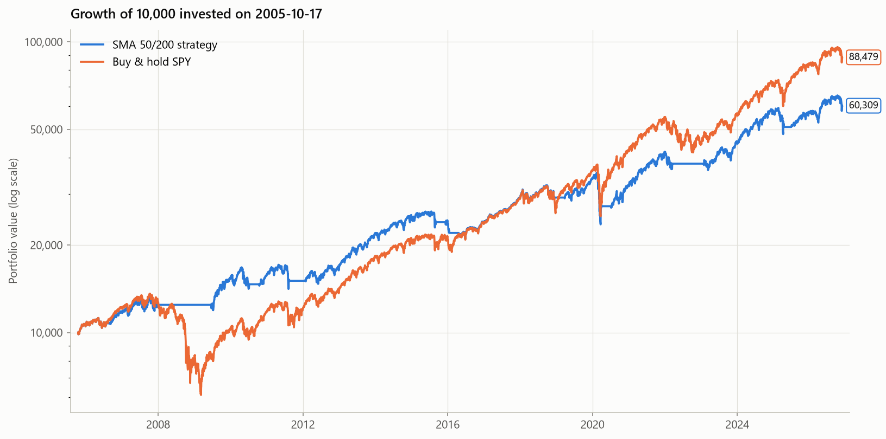
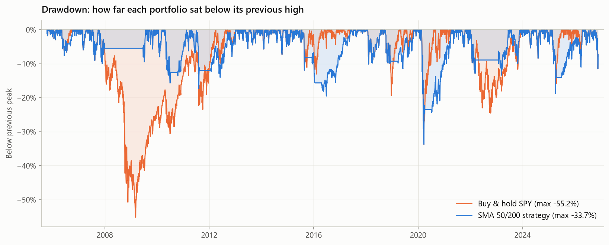
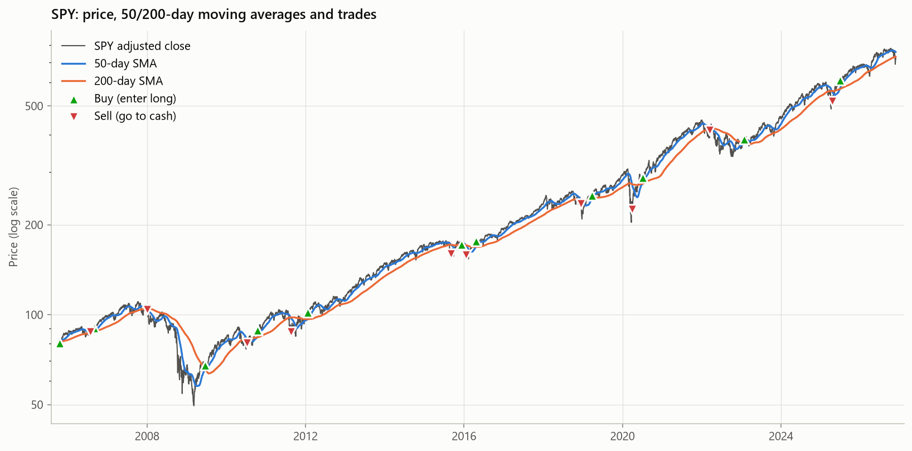
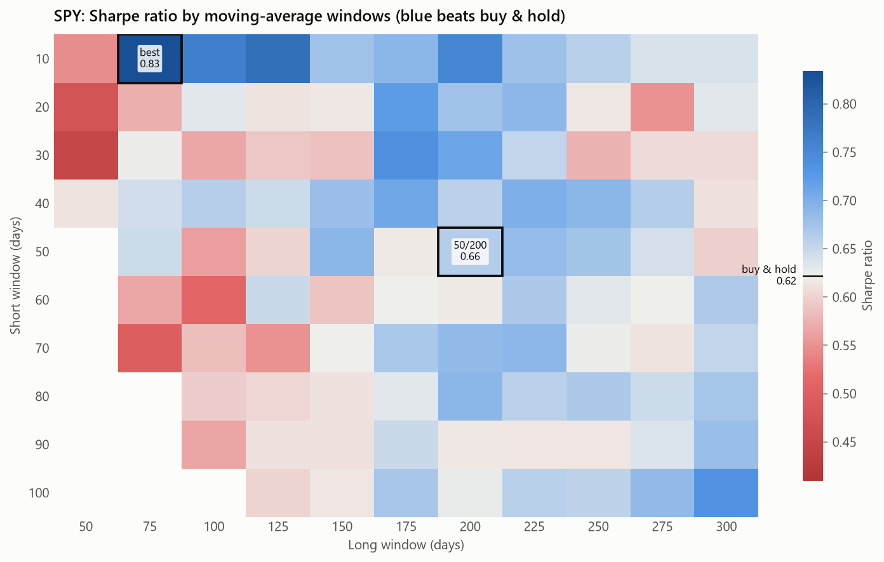

# Moving Average Crossover Backtest

A from-scratch backtest of a moving average crossover on SPY, compared with buy-and-hold.
Plain pandas/numpy, no backtesting framework, with tests that check there's no look-ahead bias.

**Result in one line:** over 2005–2026 the 50/200-day crossover had a lower return than
buy-and-hold (8.9% vs 10.9% a year) and about the same Sharpe ratio (0.68 vs 0.64), but a
much smaller worst loss (−34% vs −55%). Tuning the windows didn't hold up out of sample.



## Strategy

- Compute the 50-day and 200-day simple moving averages (SMA) of the daily adjusted close.
- **Signal:** 1 when SMA50 > SMA200, otherwise 0. Computed at each day's close.
- **Position:** the signal shifted forward one day. A signal from Monday's close is held
  during Tuesday, so the backtest never earns a return it couldn't have known how to trade.
- **Returns:** `position × daily asset return − cost × (position changed)`, with a default cost
  of 0.1% per trade. When the strategy is out of the market it holds cash at 0%.
- **Benchmark:** buy-and-hold SPY over the same dates, paying one entry cost.

Both portfolios start with 10,000 on the first day the 200-day average exists (2005-10-17).

## Results

SPY, 2005-10-17 to 2026-11-24, 0.1% cost per trade, 0% risk-free rate:

| Metric                | SMA 50/200 | Buy & hold |
|-----------------------|-----------:|-----------:|
| Total return          |     503.1% |     784.8% |
| CAGR                  |       8.9% |      10.9% |
| Annualized volatility |      13.9% |      19.2% |
| Sharpe ratio          |       0.68 |       0.64 |
| Max drawdown          |     −33.7% |     −55.2% |
| Number of trades      |         21 |          1 |
| Time in market        |      79.2% |     100.0% |

The strategy pays for itself in slow bear markets: it exited in early 2008 and its worst
drawdown in 2008–09 was about −10%, against −55% for buy-and-hold. It doesn't help in fast
crashes. In March 2020 the sell signal arrived after the bottom, so both portfolios fell the
same −33.7%. The rest of the time it lags, because markets mostly go up and it's out 21% of
the time.





### Parameter sensitivity

Sharpe ratio for 110 window pairs, all scored over the same dates (2006-03-13 onward). Blue
beats buy-and-hold (Sharpe 0.62 over this period), red loses to it.



61 of 110 pairs beat buy-and-hold, by small margins. The best cell (10/75, Sharpe 0.83) has
neighbours at 0.55–0.57. A real effect would vary smoothly with the window length, so this
looks like the luckiest of 110 tries rather than a better strategy.

### Out-of-sample test

The best pair was chosen on 2005–2017, then run on 2018-01-02 to 2026-11-24:

| Out of sample (2018–2026) | Best in-sample (10/75) | SMA 50/200 | Buy & hold |
|---------------------------|-----------------------:|-----------:|-----------:|
| CAGR                      |                   9.4% |       8.5% |      13.4% |
| Sharpe ratio              |                   0.80 |       0.59 |       0.75 |
| Max drawdown              |                 −21.1% |     −33.7% |     −33.7% |

That looks like a pass, so I repeated it with other split dates:

| Split | Chosen pair | Sharpe in-sample | Sharpe out-of-sample | Rank out of sample | Buy & hold out-of-sample |
|------:|------------:|-----------------:|---------------------:|-------------------:|-------------------------:|
| 2012  | 10/75       | 0.66             | 0.90                 | 3/110              | 0.89                     |
| 2014  | 40/150      | 0.92             | 0.56                 | 88/110             | 0.80                     |
| 2016  | 30/175      | 0.77             | 0.72                 | 21/110             | 0.84                     |
| 2018  | 10/75       | 0.86             | 0.80                 | 4/110              | 0.75                     |
| 2020  | 30/175      | 0.85             | 0.58                 | 56/110             | 0.74                     |
| 2022  | 10/75       | 0.90             | 0.59                 | 58/110             | 0.64                     |

Buy-and-hold had the higher out-of-sample Sharpe for four of six splits and tied a fifth.
The tuned pair usually lost Sharpe out of sample. The 2018 result is a favourable draw, not
evidence of an edge. With 10–20 years of daily data, the standard error of a Sharpe ratio is
roughly 1/√years (0.2–0.3), so none of these differences are statistically meaningful.

**Conclusion:** on SPY, a moving average crossover lowers volatility and drawdowns. It
doesn't reliably beat buy-and-hold, and choosing its windows from the backtest overfits.

## How to run

Requires Python 3.11+.

```bash
python -m venv .venv
.venv\Scripts\activate            # Windows
# source .venv/bin/activate       # macOS / Linux
pip install -r requirements.txt

python main.py                                                          # SPY 50/200 from 2005
python main.py --ticker SPY --short 50 --long 200 --start 2005-01-01 --cost 0.001
python main.py --sweep --oos                                            # + heatmap and out-of-sample test
python main.py --help
pytest                                                                  # 25 tests, < 1 s
```

The first run downloads prices from Yahoo Finance and caches them in `data/`. Use `--refresh`
to download again. Charts are written to `results/` and overwrite the ones in this README.
Use `--no-plots` when trying other settings.

The walkthrough notebook (`notebooks/walkthrough.ipynb`) shows the same results with more
commentary, including the split-date table above. To run it yourself: `pip install jupyter`.

**SSL certificate errors:** yfinance's HTTP client uses its own certificate bundle. If
antivirus software or a corporate proxy inspects HTTPS traffic, downloads fail with
`unable to get local issuer certificate`. Fix it by pointing `CURL_CA_BUNDLE` to a bundle
that includes the proxy's root certificate. Don't disable verification.

## Project structure

```
├── main.py              CLI: loads data, runs backtest, optional sweep / out-of-sample test
├── src/
│   ├── data.py          download from Yahoo Finance, cache as CSV, validate
│   ├── strategy.py      SMAs, signal, one-day-shifted position
│   ├── backtest.py      returns, costs, equity curves; parameter sweep; out-of-sample test
│   ├── metrics.py       total return, CAGR, volatility, Sharpe, drawdown, trades, time in market
│   └── plots.py         charts saved to results/
├── tests/               pytest, on hand-made price series
├── notebooks/           walkthrough.ipynb
└── results/             charts and metrics CSV used in this README
```

## Design notes

- **No look-ahead bias.** The only defence is one line,
  `position = signal.shift(1)`, so it's tested from two sides. One test checks that a price
  jump which triggers a buy is not earned. The other checks that rewriting all prices from
  day k onward changes nothing the strategy did up to day k. Removing the shift makes 6
  tests fail.
- **Same dates for every comparison.** The warm-up period is excluded from both strategy and
  benchmark. In the sweep, every pair starts after the longest window has warmed up.
- **Adjusted prices.** Returns include dividends (about 1.5–2% a year for SPY). Raw prices
  would understate buy-and-hold.
- **Metrics take daily returns**, not the backtest table, so they're easy to test and reuse.

## Limitations

- **Fills at the signal day's close.** With close-to-close returns and a one-day shift, the
  trade is effectively filled at the close that produced the signal. In practice you'd trade
  the next open or close, at a slightly different price.
- **Simple cost model.** A flat 0.1% per trade, with no separate slippage, spread changes,
  or market impact. Fine for one liquid ETF; optimistic for fast signals or illiquid assets.
- **Cash earns 0%.** When the strategy is out of the market it should earn the risk-free
  rate. With `--rf > 0` the Sharpe ratio subtracts it, but the cash periods don't earn it,
  so the strategy is slightly understated.
- **No taxes.** Every sell in a taxable account realizes gains. Buy-and-hold defers them.
  After tax, the gap would widen in favour of buy-and-hold.
- **Single asset, chosen with hindsight.** SPY is the most successful major market of the
  period. That's a survivorship bias at the market level: nobody tests this on an index
  that went to zero. Results on other assets, or other countries, could differ a lot.
- **Test set not fully clean.** The heatmap over the full period was viewed before the
  out-of-sample test was run. Properly, the test period should stay unseen until the end.
- **One data source.** Yahoo Finance adjusted prices can be revised and aren't
  point-in-time. Good enough for daily ETF data, not for research-grade work.
- **Long or cash only.** No shorting, leverage, or position sizing.
- **Past ≠ future.** Twenty years include only a few bear markets. The strategy's main
  benefit depends on crashes being slow enough for a 200-day average to react, and nothing
  guarantees that.

Data as of 2026-11-24.
